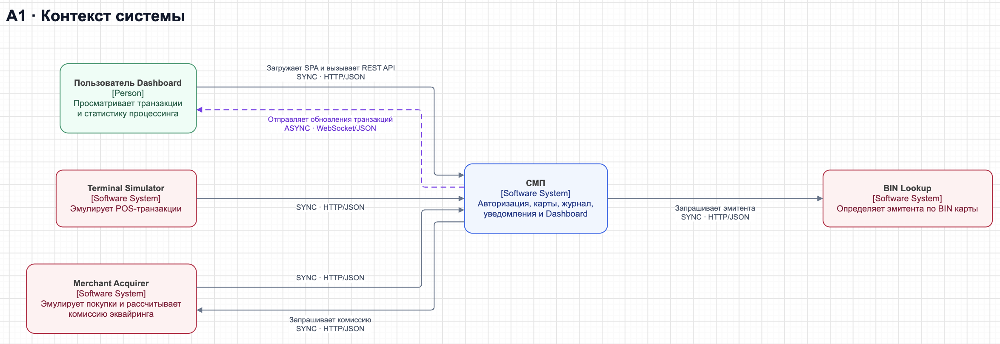

# А1 — C4 Context

## Чего не хватало и что добавлено

В [исходной схеме][oldarch] сервисы раскрыты сразу: отдельной карты границы СМП нет. Здесь СМП показана одним блоком, внешние роли отделены от ядра, подписаны направления и протоколы. «Внешний» означает роль относительно процессинга, а не размещение вне Docker Compose.

## Подтверждение связей кодом

| Связь | Основание |
|---|---|
| Терминал → СМП | [Terminal GatewayClient][termclient]: `sendToGateway()` отправляет POST в Gateway, `getCardsFromCardManager()` читает CMS напрямую. |
| Мерчант → СМП | [Merchant GatewayClient][merchclient]: `processAuthorize()` и `getCards()` используют Gateway. |
| СМП → мерчант | [MerchantAcquirerClient.fetchAcquiringFee()][feeclient]: отдельный HTTP-запрос комиссии из Switch; это не AMQP. |
| Пользователь ↔ Dashboard | [nginx.conf][nginx]: SPA, `/api/` → Gateway, `/ws/` → Logger; [useWebSocket()][ws] открывает `/ws/transactions`. |
| СМП → BIN Lookup | [BinLookupClient.getIssuerId()][binclient]: HTTP, таймауты 3/5 с, при ошибке `Optional.empty()`. |
| Физическое размещение | [docker-compose.yaml][compose]: эмуляторы и BIN Lookup поднимаются локально вместе с СМП. |

[oldarch]: ../../../docs/architecture.md
[termclient]: ../../../services/terminal-simulator/src/main/java/com/processing/terminalsimulator/client/GatewayClient.java
[merchclient]: ../../../services/merchant-acquirer/src/main/java/com/processing/merchantacquirer/client/GatewayClient.java
[feeclient]: ../../../services/switch/src/main/java/com/processing/service/MerchantAcquirerClient.java
[nginx]: ../../../services/dashboard/nginx.conf
[ws]: ../../../services/dashboard/src/hooks/useWebSocket.ts
[binclient]: ../../../services/authorization/src/main/java/com/processing/authorization/client/BinLookupClient.java
[compose]: ../../../docker-compose.yaml
