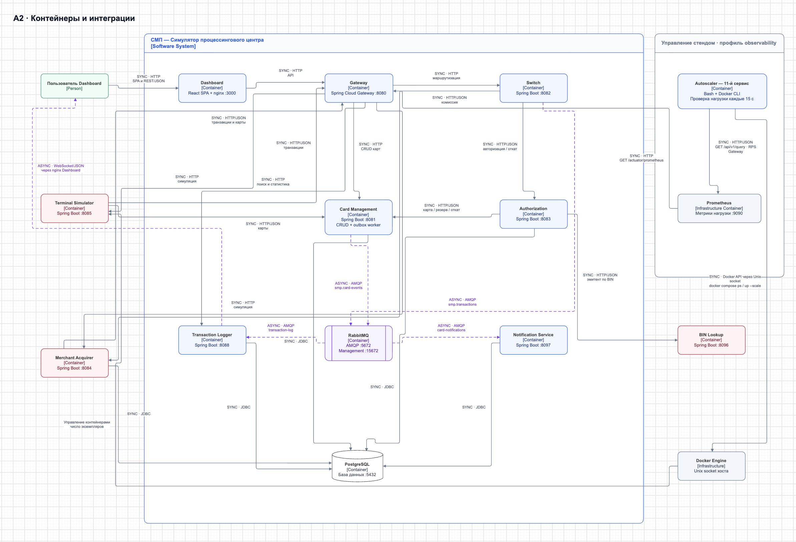

# А2 — C4 Container

## Чего не хватало и что добавлено

В [PlantUML][oldpuml] и [исходной Mermaid-схеме][oldarch] нет системной разметки sync/async, JDBC Merchant и запроса комиссии из Switch. Здесь эти связи добавлены, outbox подписан как часть CMS, WebSocket отделён от AMQP, состав сверён с [Compose][compose]. Добавлен 11-й сервис — Autoscaler из профиля `observability`.

Показаны 10 основных сервисов и Autoscaler. PostgreSQL, RabbitMQ и Prometheus — инфраструктурные контейнеры; Docker Engine — среда управления контейнерами. Prometheus показан как источник метрики для Autoscaler. Порты основных сервисов — адреса доступа с хоста; внутри Compose Java-сервисы слушают 8080.

## Подтверждение кодом

- Перечень, сети, профиль и внутренние адреса: [Compose][compose].
- Autoscaler → Prometheus → Gateway и Autoscaler → Docker Engine → Terminal Simulator: [autoscaler.sh][autoscaler], [Prometheus scrape config][prometheus]. Скрипт вычисляет число экземпляров по RPS Gateway; Compose монтирует Docker socket и включает сервис только в профиле `observability`.
- HTTP-маршруты входа: [Gateway routes][gatewayroutes]; эмуляторы: [Terminal client][termclient], [Merchant client][merchclient].
- Switch → Authorization/Merchant и публикация: [RouteService.route()][route], [AuthorizationClient][authclient], [MerchantAcquirerClient][feeclient], [LoggerClient][loggerclient].
- Authorization → CMS/BIN/БД: [AuthServiceImpl][auth], [CardManagementClientImpl][cmsclient], [BinLookupClient][binclient], [LimitUsageRepository][limits].
- JDBC CMS и outbox: [CardRepositoryPersistenceAdapter][cardrepo], [OutboxJpaAdapter][outboxrepo], [OutboxProcessor][scheduler]. JDBC Merchant: [application.yaml][merchconfig] и его Spring Data-репозитории.
- Очереди: [Switch RabbitMQConfig][swrabbit], [CMS RabbitMQConfig][cmsrabbit]; сохранение consumer: [TransactionService][logservice], [CardEventListener][notifylistener].
- REST и WebSocket Dashboard: [nginx.conf][nginx], [useWebSocket()][ws].

[oldpuml]: ../../../docs/architecture-diagram.puml
[oldarch]: ../../../docs/architecture.md
[compose]: ../../../docker-compose.yaml
[autoscaler]: ../../../scripts/autoscaler.sh
[prometheus]: ../../../infra/prometheus/prometheus.yml
[gatewayroutes]: ../../../services/gateway/src/main/resources/application.yml
[termclient]: ../../../services/terminal-simulator/src/main/java/com/processing/terminalsimulator/client/GatewayClient.java
[merchclient]: ../../../services/merchant-acquirer/src/main/java/com/processing/merchantacquirer/client/GatewayClient.java
[route]: ../../../services/switch/src/main/java/com/processing/service/RouteService.java
[authclient]: ../../../services/switch/src/main/java/com/processing/service/AuthorizationClient.java
[feeclient]: ../../../services/switch/src/main/java/com/processing/service/MerchantAcquirerClient.java
[loggerclient]: ../../../services/switch/src/main/java/com/processing/service/LoggerClient.java
[auth]: ../../../services/authorization/src/main/java/com/processing/authorization/services/AuthServiceImpl.java
[cmsclient]: ../../../services/authorization/src/main/java/com/processing/authorization/client/CardManagementClientImpl.java
[binclient]: ../../../services/authorization/src/main/java/com/processing/authorization/client/BinLookupClient.java
[limits]: ../../../services/authorization/src/main/java/com/processing/authorization/repositories/LimitUsageRepository.java
[cardrepo]: ../../../services/card-management/src/main/java/com/processing/cardmanagement/repositories/CardRepositoryPersistenceAdapter.java
[outboxrepo]: ../../../services/card-management/src/main/java/com/processing/cardmanagement/repositories/OutboxJpaAdapter.java
[scheduler]: ../../../services/card-management/src/main/java/com/processing/cardmanagement/services/OutboxProcessor.java
[merchconfig]: ../../../services/merchant-acquirer/src/main/resources/application.yaml
[swrabbit]: ../../../services/switch/src/main/java/com/processing/config/RabbitMQConfig.java
[cmsrabbit]: ../../../services/card-management/src/main/java/com/processing/cardmanagement/config/RabbitMQConfig.java
[logservice]: ../../../services/transaction-logger/src/main/java/com/processing/transactionlogger/service/TransactionService.java
[notifylistener]: ../../../services/notification-service/src/main/java/com/processing/notification/listener/CardEventListener.java
[nginx]: ../../../services/dashboard/nginx.conf
[ws]: ../../../services/dashboard/src/hooks/useWebSocket.ts
