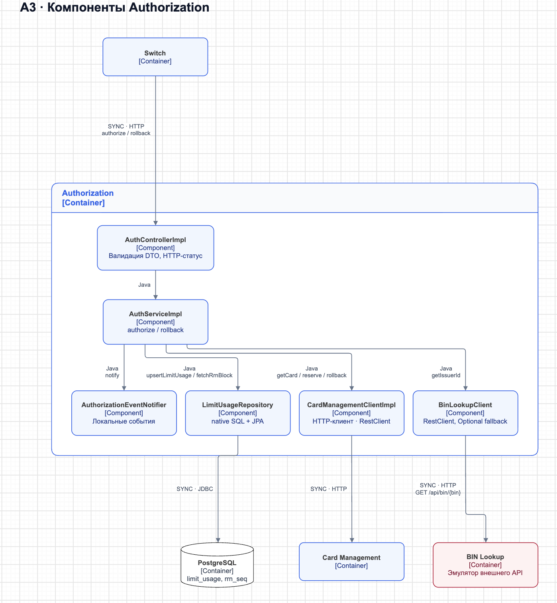
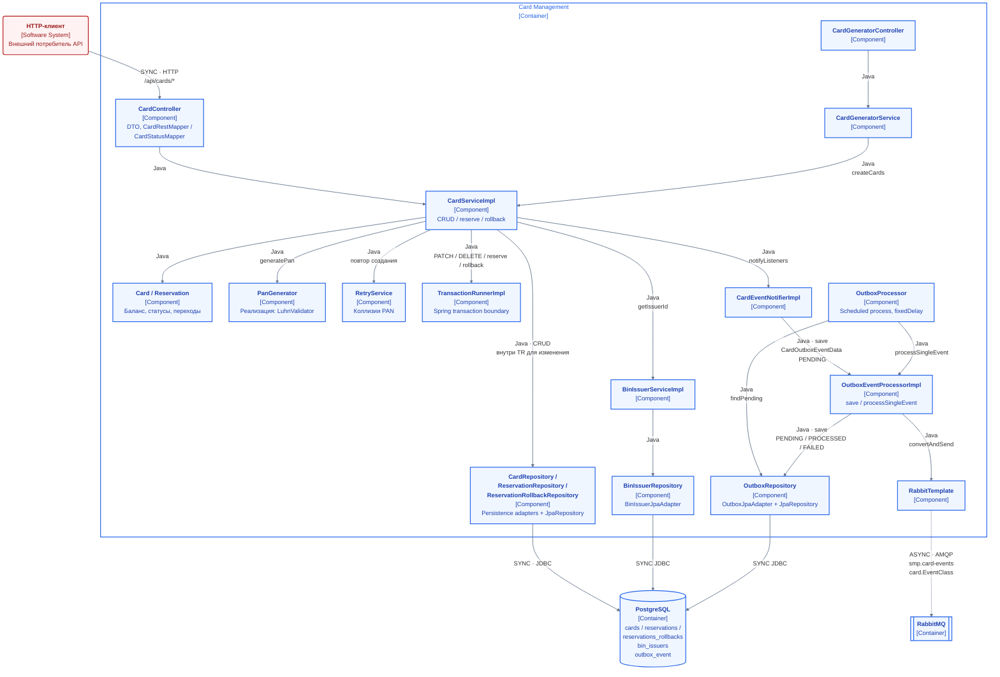

# А3 — C4 Component для Authorization и Card Management

## Чего не хватало и что добавлено

[Исходная архитектура][oldarch] не раскрывает внутренности сервисов. Добавлены контроллеры, бизнес-логика, HTTP-клиенты, persistence-адаптеры и отдельный outbox worker. Сплошные связи внутри сервиса — вызовы Java, а не сетевой HTTP; сетевые границы явно подписаны.

## Authorization

Основания: [AuthControllerImpl][authcontroller], [AuthServiceImpl][auth], [CardManagementClientImpl][cmsclient], [BinLookupClient][binclient], [LimitUsageRepository][limits].

- `authorize()` начинает локальную транзакцию БД; чтение карты и reserve — отдельные HTTP-вызовы в CMS. Единой ACID-транзакции двух сервисов нет.
- Порядок: `getCard` → BIN Lookup → статус → срок → баланс → `upsertLimitUsage` → RRN → reserve → authCode. Срок сравнивается с UTC-датой `transmissionDateTime`, а не только с системными часами.
- Правило дневного/месячного лимита находится **в SQL репозитория**. Мок, возвращающий `0` или `1`, проверяет реакцию сервиса, но не арифметику/атомарность SQL.
- Результат BIN Lookup используется для записи в лог. Он не подменяет `request.issuerId()` и не определяет решение об одобрении.
- Пойманная ошибка reserve превращается в обычный DECLINED-ответ. Само `rollbackFor` не доказывает отмену ранее обновлённого usage: исключение обработано внутри метода. Отдельный `rollback()` вызывает только CMS и usage не компенсирует.

## Card Management

Настройка бинов и адаптеров подтверждается [AppConfig][cmsapp]; бизнес-методы — [CardServiceImpl][cardservice], [Card][card], [Reservation][reservation]; контроллер — [CardController][cardcontroller].

Ветка пакетной генерации: [CardGeneratorController][generatorcontroller] → [CardGeneratorService.generate()][generator] → `CardServiceImpl.createCards()`. Генератор распределяет карты по BIN и создаёт набор статусов ACTIVE/INACTIVE/BLOCKED.

События идут по цепочке [CardEventNotifierImpl][notifier] → [OutboxEventProcessorImpl][outbox] → [OutboxJpaAdapter][outboxrepo]. Публикацию инициирует [OutboxProcessor][scheduler], а не HTTP-контроллер. Таблица и поля статуса заданы в [миграции V5.5][outboxmigration].

[oldarch]: ../../../docs/architecture.md
[authcontroller]: ../../../services/authorization/src/main/java/com/processing/authorization/controller/AuthControllerImpl.java
[auth]: ../../../services/authorization/src/main/java/com/processing/authorization/services/AuthServiceImpl.java
[cmsclient]: ../../../services/authorization/src/main/java/com/processing/authorization/client/CardManagementClientImpl.java
[binclient]: ../../../services/authorization/src/main/java/com/processing/authorization/client/BinLookupClient.java
[limits]: ../../../services/authorization/src/main/java/com/processing/authorization/repositories/LimitUsageRepository.java
[cmsapp]: ../../../services/card-management/src/main/java/com/processing/cardmanagement/configuration/AppConfig.java
[cardservice]: ../../../services/card-management/src/main/java/com/processing/cardmanagement/services/CardServiceImpl.java
[card]: ../../../services/card-management/src/main/java/com/processing/cardmanagement/models/Card.java
[reservation]: ../../../services/card-management/src/main/java/com/processing/cardmanagement/models/Reservation.java
[cardcontroller]: ../../../services/card-management/src/main/java/com/processing/cardmanagement/controllers/CardController.java
[generatorcontroller]: ../../../services/card-management/src/main/java/com/processing/cardmanagement/controllers/CardGeneratorController.java
[generator]: ../../../services/card-management/src/main/java/com/processing/cardmanagement/services/CardGeneratorService.java
[notifier]: ../../../services/card-management/src/main/java/com/processing/cardmanagement/events/CardEventNotifierImpl.java
[outbox]: ../../../services/card-management/src/main/java/com/processing/cardmanagement/services/OutboxEventProcessorImpl.java
[outboxrepo]: ../../../services/card-management/src/main/java/com/processing/cardmanagement/repositories/OutboxJpaAdapter.java
[scheduler]: ../../../services/card-management/src/main/java/com/processing/cardmanagement/services/OutboxProcessor.java
[outboxmigration]: ../../../services/card-management/src/main/resources/db/migration/V5.5__init_outbox_events_table.sql
[runner]: ../../../services/card-management/src/main/java/com/processing/cardmanagement/services/TransactionRunnerImpl.java
[cardjpa]: ../../../services/card-management/src/main/java/com/processing/cardmanagement/repositories/CardJpaRepository.java
[cmsconfig]: ../../../services/card-management/src/main/resources/application.properties
[outboxmodel]: ../../../services/card-management/src/main/java/com/processing/cardmanagement/models/CardOutboxEventData.java
