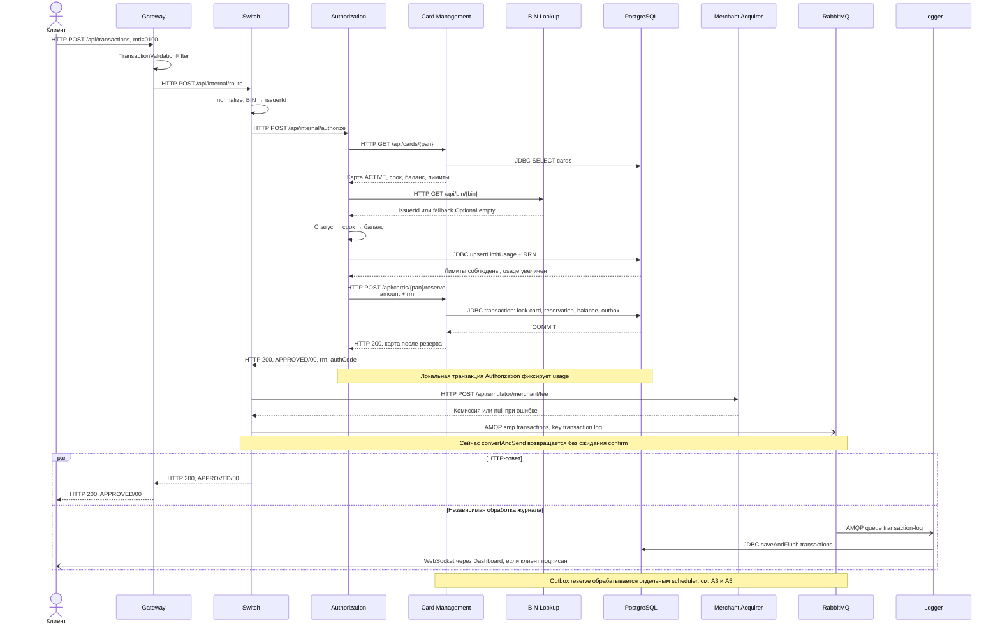
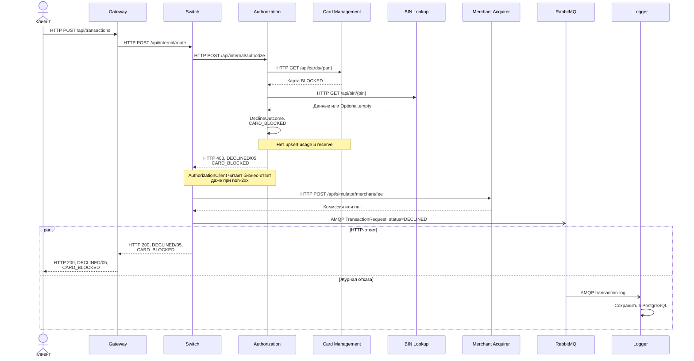
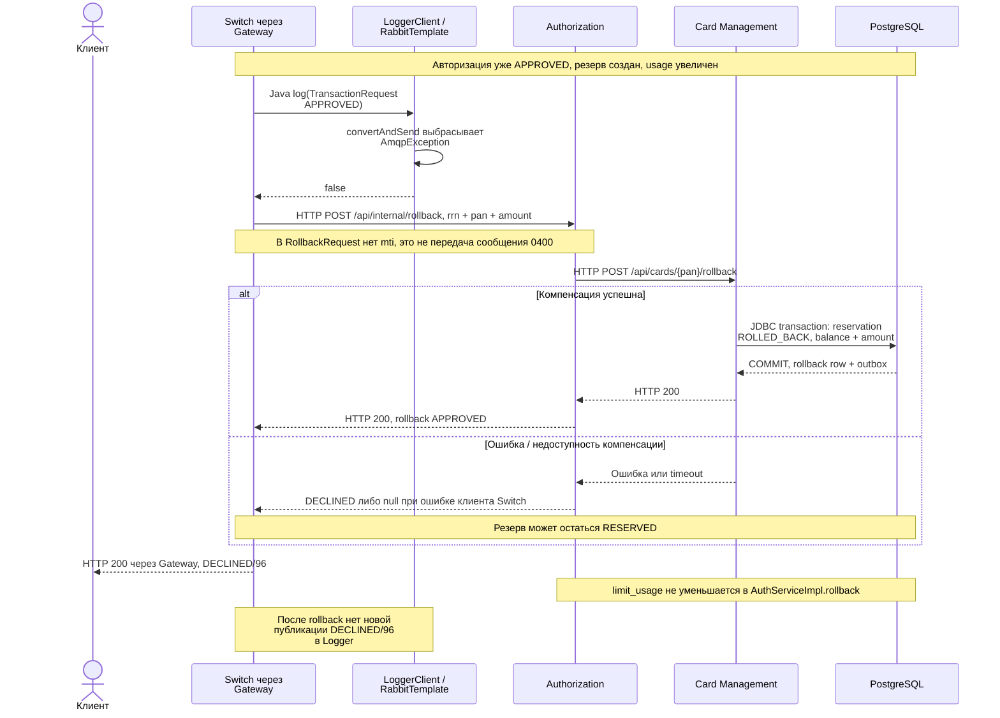
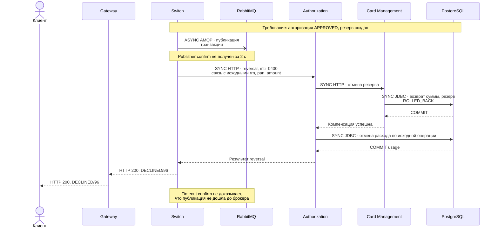

# А4 — Sequence транзакции

## Чего не хватало и что добавлено

[Исходная sequence][oldarch] объединяет happy path и короткую ветку declined, но не раскрывает BLOCKED и компенсацию при сбое публикации. В ней также переставлены CMS/BIN и лимиты/баланс. Ниже показаны три фактических сценария и отдельно — требуемый, но не реализованный сценарий confirm-timeout с reversal `0400`.

## Happy path

Код: [Gateway routes][gatewayroutes], [RouteService.route()][route], [AuthServiceImpl.authorize()][auth], [CardServiceImpl.reserve()][cardservice], [LoggerClient.log()][loggerclient], [TransactionLogListener][loglistener], [TransactionService.store()][logservice].

## Declined при BLOCKED

Код: [DeclineOutcome][declines], [AuthControllerImpl.authorize()][authcontroller], [AuthorizationClient.callAuthorize()][authclient], [RouteController.routeTransaction()][routecontroller], [RouteService][route]. HTTP 403 **внутреннего Authorization** и HTTP 200 **Gateway/Switch** — разные контракты.

## Реальная компенсация при ошибке публикации

Код: [LoggerClient][loggerclient] ловит `AmqpException`; [RouteService][route] инициирует rollback только для первоначального APPROVED. [AuthorizationClient.rollback()][authclient] создаёт [RollbackRequest][rollbackrequest]. [AuthServiceImpl.rollback()][auth] и [CardServiceImpl.rollback()][cardservice] реализуют компенсацию. При исходном DECLINED ошибка логирования не инициирует rollback.

## Требуемый сценарий: confirm-timeout и reversal 0400

Сценарий из задания А4–А5 и [ТЗ Authorization: reversal][authtz]. **Эта диаграмма описывает требование, а не текущую реализацию.** Показано продолжение успешной авторизации с уже созданным резервом; HTTP-маршрут приёма reversal `0400` в коде отсутствует.

### Отличия от кода

| Чего нет | Что есть в коде |
|---|---|
| Ожидания publisher confirm до 2 секунд перед ответом APPROVED | В [настройках Switch][swconfig] включён `publisher-confirm-type: correlated`, но [LoggerClient.log()][loggerclient] возвращает `true` сразу после `convertAndSend()`, без ожидания ack. `logger-read-timeout-ms: 2000` относится к HTTP, а не к AMQP confirm. |
| Компенсации по nack или истечению таймаута confirm | [LoggerClient][loggerclient] возвращает `false` при синхронном `AmqpException`. Только этот результат после первоначального APPROVED запускает rollback в [RouteService.route()][route]. Отдельной обработки nack/confirm-timeout в этом пути нет. |
| Отправки reversal-сообщения с `mti=0400` при компенсации | [AuthorizationClient.rollback()][authclient] отправляет HTTP `POST /api/internal/rollback` с [RollbackRequest][rollbackrequest]: `rrn`, `pan`, `amount`, без MTI. Метод [AuthorizationRequest.forReversal()][authrequest] создаёт DTO с `0400`, но вызовов этого метода в коде нет. |
| Приёма `mti=0400` через транзакционный вход Gateway | [TransactionRequestValidator][validator] принимает только `0100`; другое значение MTI отклоняется валидацией. |

[oldarch]: ../../../docs/architecture.md
[gatewayroutes]: ../../../services/gateway/src/main/resources/application.yml
[route]: ../../../services/switch/src/main/java/com/processing/service/RouteService.java
[auth]: ../../../services/authorization/src/main/java/com/processing/authorization/services/AuthServiceImpl.java
[cardservice]: ../../../services/card-management/src/main/java/com/processing/cardmanagement/services/CardServiceImpl.java
[loggerclient]: ../../../services/switch/src/main/java/com/processing/service/LoggerClient.java
[loglistener]: ../../../services/transaction-logger/src/main/java/com/processing/transactionlogger/listener/TransactionLogListener.java
[logservice]: ../../../services/transaction-logger/src/main/java/com/processing/transactionlogger/service/TransactionService.java
[declines]: ../../../services/authorization/src/main/java/com/processing/authorization/constants/DeclineOutcome.java
[authcontroller]: ../../../services/authorization/src/main/java/com/processing/authorization/controller/AuthControllerImpl.java
[authclient]: ../../../services/switch/src/main/java/com/processing/service/AuthorizationClient.java
[routecontroller]: ../../../services/switch/src/main/java/com/processing/controller/RouteController.java
[rollbackrequest]: ../../../services/common/src/main/java/com/processing/common/dto/authorization/RollbackRequest.java
[swconfig]: ../../../services/switch/src/main/resources/application.yml
[authrequest]: ../../../services/common/src/main/java/com/processing/common/dto/authorization/AuthorizationRequest.java
[validator]: ../../../services/gateway/src/main/java/com/processing/gateway/validation/TransactionRequestValidator.java
[authtz]: ../../../tz/04-authorization.md
