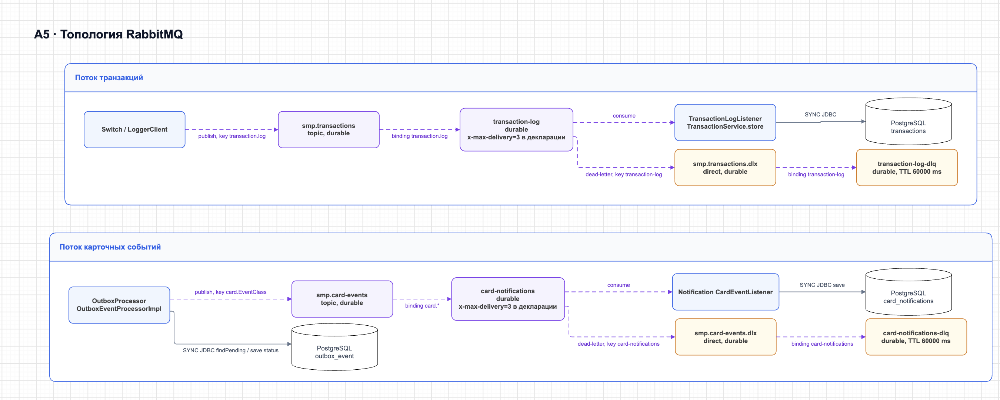

# А5 — RabbitMQ топология и гарантии доставки

## Чего не хватало и что добавлено

В [архитектуре][oldarch] есть таблица маршрутов, но нет полной схемы main exchange → queue → consumer и DLX/DLQ. Ниже визуализированы оба потока, точные routing key, TTL и места ошибок. Отдельно разобраны три разных механизма: publisher confirm, повтор публикации outbox и повтор обработки consumer.

Пунктирные стрелки — асинхронный AMQP-поток, сплошные — локальная работа/синхронный JDBC. Стрелки в DLQ показывают маршруты dead-lettering; количество попыток обработки разобрано отдельно ниже.

[drawio](../content/05-rabbitmq.drawio)

## Точная декларация

| Exchange | Тип | Очередь | Binding key | Где объявлено |
|---|---|---|---|---|
| `smp.transactions` | topic | `transaction-log` | `transaction.log` | [Switch RabbitMQConfig][swrabbit], [Logger RabbitMQConfig][lograbbit] |
| `smp.transactions.dlx` | direct | `transaction-log-dlq` | `transaction-log` | [Switch RabbitMQConfig][swrabbit] |
| `smp.card-events` | topic | `card-notifications` | `card.*` | [CMS RabbitMQConfig][cmsrabbit], [Notification RabbitMQConfig][notifyrabbit] |
| `smp.card-events.dlx` | direct | `card-notifications-dlq` | `card-notifications` | CMS и Notification |

Logger объявляет основную очередь с DLX-аргументами, но сам DLX и DLQ для транзакций создаёт конфигурация Switch. В изолированном тесте Logger нужно импортировать полную топологию или явно объявлять её: одного запуска Logger недостаточно для воспроизведения всего DLQ-пути.

Реальные ключи CMS: `card.CardServiceCreationEvent`, `card.CardServicePatchEvent`, `card.CardServiceDeletionEvent`, `card.CardServiceReserveEvent`, `card.CardServiceRollbackEvent`. `card.*` — шаблон привязки, **не** ключ каждой публикации. [OutboxEventProcessorImpl][outbox] добавляет префикс к имени класса события. Например, [CreationEvent][creationevent] содержит `amount` (число созданных карт), а [PatchEvent][patchevent] — `pan`; нельзя ожидать полный объект карты в каждом уведомлении.

## Подтверждения и повторы

| Механизм | Требование/описание | Фактическая реализация и проверка |
|---|---|---|
| Confirm Switch | После APPROVED ждать ack до 2 с; при nack/timeout компенсировать резерв | [Настройка correlated][swconfig] есть. [LoggerClient.log()][loggerclient] не использует callback/future и возвращает `true` после `convertAndSend`. Ветка rollback вызывается при пойманном `AmqpException`, не при отдельно проверенном таймауте confirm. N-14 проверяет разрыв требования, N-15 — действующий путь. |
| Confirm outbox | Не потерять карточное событие | В [CMS][cmsconfig] также включён correlated, но [processor][outbox] помечает PROCESSED сразу после возврата отправки. PROCESSED не доказывает ack и тем более сохранение Notification. |
| Outbox retry | 3 попытки, затем FAILED | [OutboxProcessor][scheduler] опрашивает PENDING с `retryCount < 3`, [processor][outbox] при исключении увеличивает счётчик. По умолчанию fixed delay 1000 мс, не exponential backoff. После третьей ошибки событие остаётся в БД со статусом FAILED. Это не помещение сообщения в RabbitMQ DLQ. |
| Consumer retry | До 3 попыток, затем DLQ | В декларациях очередей указан `x-max-delivery=3`. В [Logger config][logconfig] и [Notification config][notifyconfig] нет явной настройки трёх попыток listener retry. N-18 и N-21 измеряют реальные вызовы Logger и Notification соответственно. |
| DLQ TTL | 60 с | В обеих DLQ задан `x-message-ttl=60000`. Это срок хранения сообщения в DLQ, не задержка повтора и не TTL основной очереди. Обратной привязки в main queue нет. Проверяется отдельно в N-22. |

[oldarch]: ../../../docs/architecture.md
[swrabbit]: ../../../services/switch/src/main/java/com/processing/config/RabbitMQConfig.java
[lograbbit]: ../../../services/transaction-logger/src/main/java/com/processing/transactionlogger/config/RabbitMQConfig.java
[cmsrabbit]: ../../../services/card-management/src/main/java/com/processing/cardmanagement/config/RabbitMQConfig.java
[notifyrabbit]: ../../../services/notification-service/src/main/java/com/processing/notification/config/RabbitMQConfig.java
[outbox]: ../../../services/card-management/src/main/java/com/processing/cardmanagement/services/OutboxEventProcessorImpl.java
[creationevent]: ../../../services/card-management/src/main/java/com/processing/cardmanagement/events/CardServiceCreationEvent.java
[patchevent]: ../../../services/card-management/src/main/java/com/processing/cardmanagement/events/CardServicePatchEvent.java
[swconfig]: ../../../services/switch/src/main/resources/application.yml
[loggerclient]: ../../../services/switch/src/main/java/com/processing/service/LoggerClient.java
[cmsconfig]: ../../../services/card-management/src/main/resources/application.properties
[scheduler]: ../../../services/card-management/src/main/java/com/processing/cardmanagement/services/OutboxProcessor.java
[logconfig]: ../../../services/transaction-logger/src/main/resources/application.yaml
[notifyconfig]: ../../../services/notification-service/src/main/resources/application.yml
[loglistener]: ../../../services/transaction-logger/src/main/java/com/processing/transactionlogger/listener/TransactionLogListener.java
[notifylistener]: ../../../services/notification-service/src/main/java/com/processing/notification/listener/CardEventListener.java
[logservice]: ../../../services/transaction-logger/src/main/java/com/processing/transactionlogger/service/TransactionService.java
