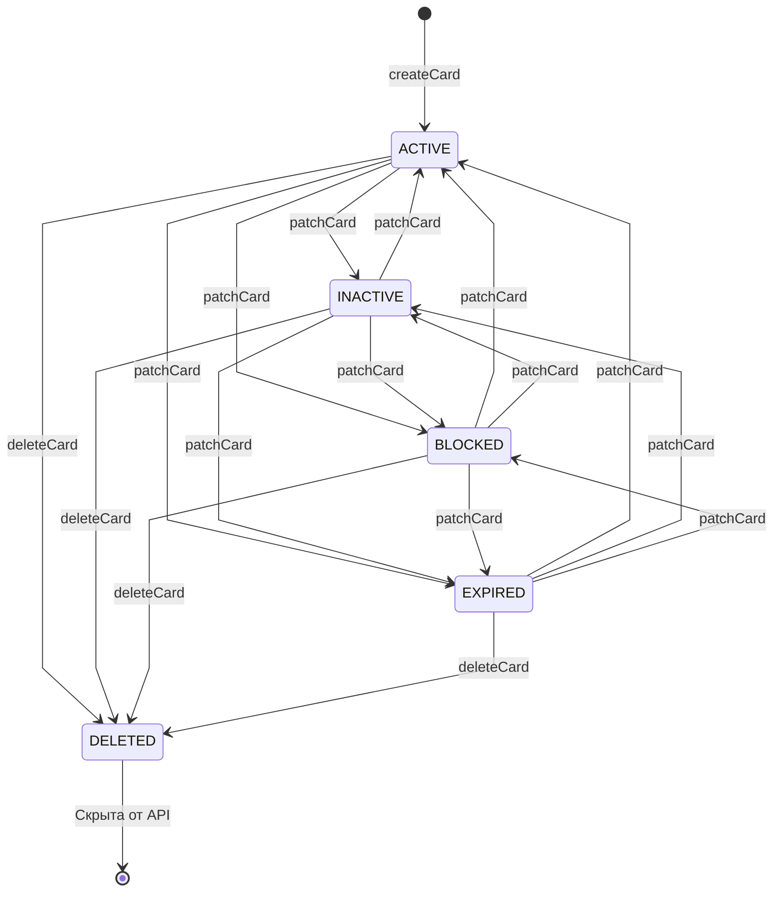
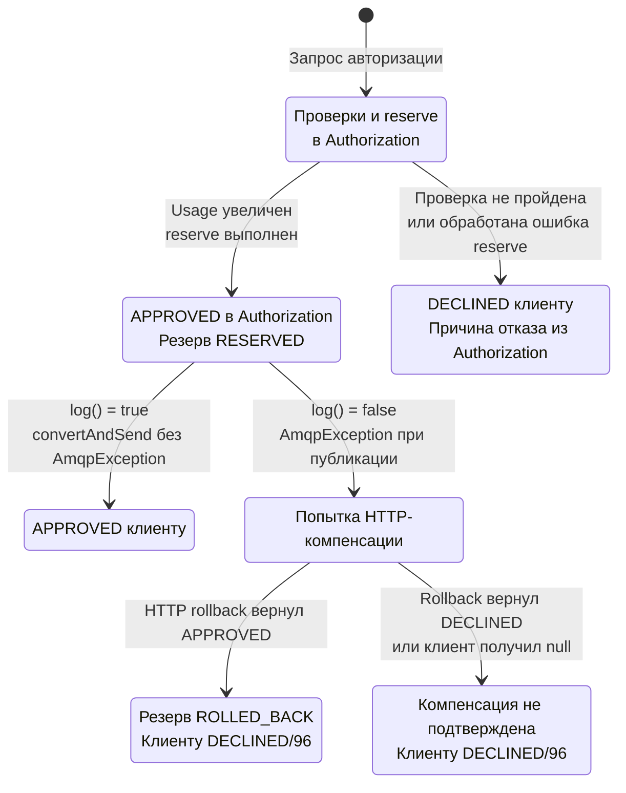

# А6 — состояния карты и жизненный цикл транзакции

## Чего не хватало и что добавлено

В [исходной архитектуре][oldarch] нет state-transition-схем. Добавлены состояния карты, допустимые изменения статуса, soft delete, результат авторизации и компенсация резерва. Главное уточнение: `CardStatus`, `TransactionStatus` и `ReservationStatus` — **три разных типа**, а не один общий автомат.

## Card.status

Все изменения показаны прямыми стрелками между статусами, без промежуточных узлов. `patchCard` означает `PATCH /api/cards/{pan}` с полем `status`, равным статусу назначения; `deleteCard` — `DELETE /api/cards/{pan}`. На одной схеме сохранены все 12 направленных переходов между ACTIVE, INACTIVE, BLOCKED и EXPIRED и удаление из каждого из этих состояний.

Основания: [CardStatus][cardstatus], [CardController.patchCard/deleteCard][cardcontroller], [CardServiceImpl.patchCard/deleteCard][cardservice], [Card.withData/deleted][card], [CardEntity][cardentity]. `patchCard()` не задаёт матрицу ограничений между ACTIVE, INACTIVE, BLOCKED и EXPIRED: любое значение enum передаётся в новую модель. Поэтому все переходы между этими четырьмя состояниями показаны явно, в том числе INACTIVE ↔ BLOCKED, INACTIVE ↔ EXPIRED и BLOCKED ↔ EXPIRED. PATCH с текущим значением `status` или без этого поля сохраняет статус; такие петли без изменения состояния не показаны.

`DELETED` присутствует во внутреннем `CardStatus`, но отсутствует в публичном [CardModelStatus][cardmodelstatus]. Поэтому удаление — отдельная операция DELETE, а не PATCH со значением DELETED. `@SQLRestriction("status <> 'DELETED'")` скрывает удалённые карты; через обычный GET/PATCH их восстановить нельзя. Прямое изменение БД не рассматривается как API-переход.

В диаграмме `[*] → ACTIVE` относится к одиночному созданию через `createCard()`. Пакетная генерация использует `CardDraft.status` и может создавать другие статусы — это не автоматический переход по времени.

| Условие авторизации | Результат | Изменение статуса карты |
|---|---|---|
| ACTIVE, срок и остальные ограничения соблюдены | APPROVED/00 | Нет |
| INACTIVE | DECLINED/05, CARD_INACTIVE | Нет |
| BLOCKED | DECLINED/05, CARD_BLOCKED | Нет |
| EXPIRED | DECLINED/54, CARD_EXPIRED | Нет |
| ACTIVE, `expiryDate.atEndOfMonth()` раньше UTC-даты запроса | DECLINED/54 | Остаётся ACTIVE |
| DELETED скрыта репозиторием / PAN отсутствует | DECLINED/14, CARD_NOT_FOUND | Нет |

Основания таблицы: [AuthServiceImpl.authorize()][auth], [DeclineOutcome][declines]. Reserve сам по себе не меняет статус карты, только баланс и отдельную сущность резерва.

## Жизненный цикл покупки и компенсации

- [TransactionStatus][logstatus]: только `APPROVED`, `DECLINED`.
- [ReservationStatus][reservationstatus]: `RESERVED`, `ROLLED_BACK`.
- [Reservation.startRollback()][reservation]: повторный rollback после ROLLED_BACK вызывает `RollbackAlreadySatisfiedException`, который [CMS exception handler][cmserrors] преобразует в HTTP 409.

[RouteService][route] отправляет в Logger первоначальный результат Authorization **до** компенсации; отдельной корректирующей транзакции после rollback не публикует. Изменение reservation на ROLLED_BACK не обновляет запись `transactions`. Если первоначальное сообщение всё же дошло при сетевом сбое, журнал может содержать APPROVED при внешнем ответе 96 — это риск согласованности, не гарантированно воспроизведённый дефект.

Увеличение usage происходит раньше reserve. Поэтому утверждение «при любом DECLINED вообще ничего не меняется» неверно для поздних ошибок: [AuthServiceImpl][auth] ловит ошибки reserve, а `rollback()` не восстанавливает usage
- это надо доработать в сервисе

[oldarch]: ../../../docs/architecture.md
[cardstatus]: ../../../services/card-management/src/main/java/com/processing/cardmanagement/models/CardStatus.java
[cardmodelstatus]: ../../../services/common/src/main/java/com/processing/common/dto/cardmanagement/CardModelStatus.java
[cardcontroller]: ../../../services/card-management/src/main/java/com/processing/cardmanagement/controllers/CardController.java
[cardservice]: ../../../services/card-management/src/main/java/com/processing/cardmanagement/services/CardServiceImpl.java
[card]: ../../../services/card-management/src/main/java/com/processing/cardmanagement/models/Card.java
[cardentity]: ../../../services/card-management/src/main/java/com/processing/cardmanagement/models/CardEntity.java
[auth]: ../../../services/authorization/src/main/java/com/processing/authorization/services/AuthServiceImpl.java
[declines]: ../../../services/authorization/src/main/java/com/processing/authorization/constants/DeclineOutcome.java
[logstatus]: ../../../services/common/src/main/java/com/processing/common/dto/transactionlogger/TransactionStatus.java
[reservationstatus]: ../../../services/card-management/src/main/java/com/processing/cardmanagement/models/ReservationStatus.java
[reservation]: ../../../services/card-management/src/main/java/com/processing/cardmanagement/models/Reservation.java
[cmserrors]: ../../../services/card-management/src/main/java/com/processing/cardmanagement/configuration/GlobalExceptionHandler.java
[route]: ../../../services/switch/src/main/java/com/processing/service/RouteService.java
